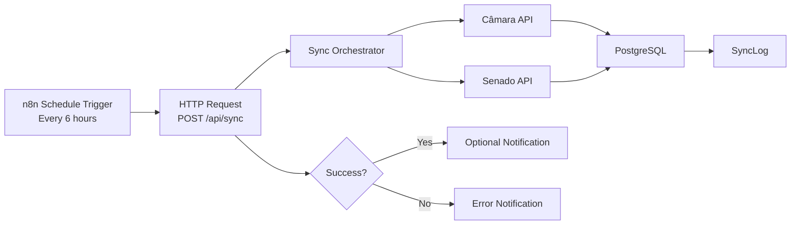

# n8n Sync Workflow Documentation

This document provides a comprehensive guide for setting up the n8n workflow that triggers the data synchronization process for the "Como Eles Votaram" platform.

## 1. Overview

The "Como Eles Votaram" platform relies on external data from the Câmara dos Deputados and Senado Federal APIs. To keep our database up to date, we expose an API endpoint (`/api/sync`) that can be triggered by a cron job or an external automation tool like n8n.

The workflow follows this high-level architecture:



## 2. Prerequisites

Before setting up the workflow, ensure you have:

1.  A running instance of **n8n** (self-hosted or cloud).
2.  The **Application URL** (`APP_URL`) of your deployed "Como Eles Votaram" instance.
3.  The **Sync Secret** (`SYNC_SECRET`) configured in your application environment variables.

## 3. Workflow Setup

Follow these steps to configure the sync workflow in n8n:

1.  **Create Workflow**: Create a new workflow and name it "Como Eles Votaram — Sync".
2.  **Add Schedule Trigger**: Add a "Schedule Trigger" node.
3.  **Configure Schedule**: Set the trigger to "Cron" and use the expression `0 */6 * * *` (every 6 hours).
4.  **Add HTTP Request**: Add an "HTTP Request" node.
5.  **Configure Request**:
    *   **Method**: `POST`
    *   **URL**: `{{ $env.APP_URL }}/api/sync`
    *   **Authentication**: None (we use a custom header).
    *   **Headers**: Add a header named `Authorization` with the value `Bearer {{ $env.SYNC_SECRET }}`.
    *   **Body Parameters**: Add a JSON body `{"source": "all"}`.
6.  **Configure Timeout**: In the node settings (Options), set the **Timeout** to `120000` ms (120 seconds) to accommodate the synchronization duration.
7.  **Add IF Node**: Connect an "IF" node to the HTTP Request to check for success.
    *   **Condition**: `{{ $json.success }}` is equal to `true`.
8.  **Setup Notifications**:
    *   **Success Path (true)**: Optionally add a Slack, Discord, or Email node to notify the team of a successful sync.
    *   **Failure Path (false)**: Add a notification node to alert the team of any sync failures, including the errors returned in `{{ $json.errors }}`.

## 4. Environment Variables

We recommend using environment variables in n8n to manage sensitive information:

| Variable | Description | Example |
| :--- | :--- | :--- |
| `APP_URL` | The base URL of the application | `https://como-eles-votaram.vercel.app` |
| `SYNC_SECRET` | The bearer token for authentication | `your-secure-sync-secret-key` |

## 5. Schedule

The synchronization is scheduled to run **every 6 hours** (`0 */6 * * *`).

The Câmara and Senado APIs do not update their data more frequently, so this interval is optimal to balance data freshness and server load.

## 6. Monitoring

You can monitor the sync process through two main channels:

### 1. Database Logs (SyncLog)
Each sync attempt is recorded in the `SyncLog` table. You can query it using Prisma Studio or SQL:

```sql
SELECT * FROM "SyncLog" ORDER BY "createdAt" DESC LIMIT 10;
```

*   **Status**: `started`, `completed`, `partial`, or `failed`.
*   **Source/Entity**: Context of what was synchronized.
*   **Error**: Detailed error messages if the sync was partial or failed.

### 2. n8n Execution History
Check the **Execution History** tab in n8n to view:
*   HTTP Status Codes (should be 200).
*   Execution Duration.
*   The exact response payload.

## 7. Troubleshooting

| Issue | Potential Cause | Solution |
| :--- | :--- | :--- |
| **401 Unauthorized** | Missing or incorrect `SYNC_SECRET` | Verify that the `Authorization` header in n8n matches the `SYNC_SECRET` environment variable in the app. |
| **Timeout Error** | Sync process exceeded 120s | Increase the timeout in the HTTP Request node or trigger partial syncs (e.g., `{"source": "camara"}`). |
| **429 Rate Limited** | Hitting Câmara/Senado API limits | Throttling is implemented in the app, but if it persists, increase the sync interval in n8n. |
| **Partial Success** | Some API requests failed | Check the `errors` array in the response or the `SyncLog` table for specific failure reasons. |
| **Network Error** | Application is unreachable | Ensure `APP_URL` is accessible from the n8n instance and that no firewall is blocking the request. |

## 8. Workflow JSON Export

Copy and paste this JSON into your n8n canvas to import the workflow:

```json
{
  "name": "Como Eles Votaram — Sync",
  "nodes": [
    {
      "parameters": {
        "rule": {
          "interval": [
            {
              "field": "cronExpression",
              "expression": "0 */6 * * *"
            }
          ]
        }
      },
      "id": "schedule-trigger-id",
      "name": "Schedule Trigger",
      "type": "n8n-nodes-base.scheduleTrigger",
      "typeVersion": 1.1,
      "position": [450, 300]
    },
    {
      "parameters": {
        "method": "POST",
        "url": "={{ $env.APP_URL }}/api/sync",
        "sendHeaders": true,
        "headerParameters": {
          "parameters": [
            {
              "name": "Authorization",
              "value": "=Bearer {{ $env.SYNC_SECRET }}"
            }
          ]
        },
        "sendBody": true,
        "specifyBody": "json",
        "jsonBody": "{\"source\": \"all\"}",
        "options": {
          "timeout": 120000
        }
      },
      "id": "http-request-id",
      "name": "Sync Trigger",
      "type": "n8n-nodes-base.httpRequest",
      "typeVersion": 4.1,
      "position": [670, 300]
    },
    {
      "parameters": {
        "conditions": {
          "boolean": [
            {
              "value1": "={{ $json.success }}",
              "value2": true
            }
          ]
        }
      },
      "id": "if-node-id",
      "name": "Is Successful?",
      "type": "n8n-nodes-base.if",
      "typeVersion": 1,
      "position": [890, 300]
    }
  ],
  "connections": {
    "Schedule Trigger": {
      "main": [
        [
          {
            "node": "Sync Trigger",
            "type": "main",
            "index": 0
          }
        ]
      ]
    },
    "Sync Trigger": {
      "main": [
        [
          {
            "node": "Is Successful?",
            "type": "main",
            "index": 0
          }
        ]
      ]
    }
  },
  "active": false,
  "settings": {
    "executionOrder": "v1"
  }
}
```
